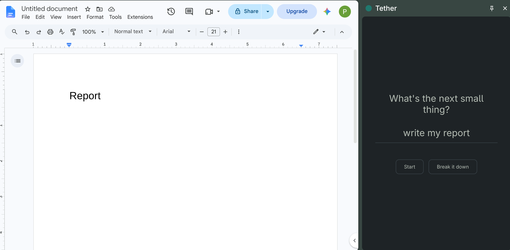
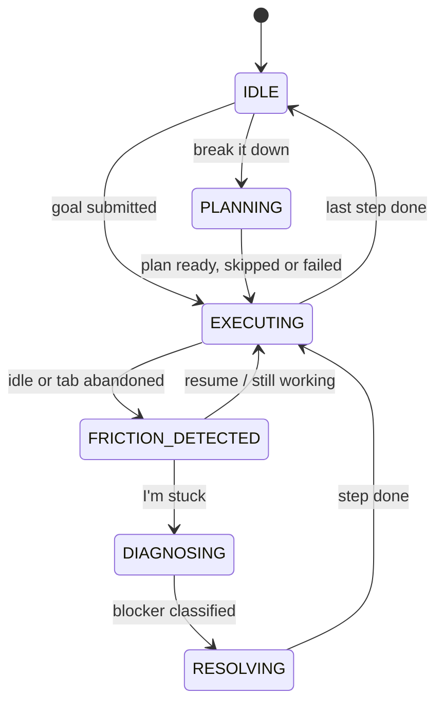

# Tether

> One small step at a time. Tether notices when you stall, asks if you're stuck, and hands you one tiny next action. Everything runs on your own machine.


**[Watch the 2-minute demo](https://youtu.be/l6_o0JbDHLI)** · **[Try it in 30 seconds](#try-it-in-30-seconds)** · [How it works](#how-it-works) · [Privacy](#privacy-in-detail)



A side-panel extension for people with executive dysfunction, ADHD or burnout. It shows one small step at a time. If you leave the tab or go quiet, it asks whether you're stuck or taking a break. If you're stuck, a small model on your own computer sorts the blocker and puts one tiny step in front of your task.

Nothing you type leaves your computer, and there's nothing to pay for.

## Install

1. Install [Ollama](https://ollama.com) and keep it running. On Linux, if it isn't running: `systemctl start ollama`.
2. In a terminal, run `ollama pull llama3.2:3b`. It's about 2 GB, once.
3. Download the latest zip from [Releases](../../releases/latest) and unzip it somewhere you'll keep it. Chrome reads the extension from that folder.
4. Open `chrome://extensions`, turn on **Developer mode**, click **Load unpacked** and pick the folder.
5. Pin Tether, then click its icon to open the side panel.

It works in Chrome, Chromium, Brave and Edge. Tabs that were open before you installed it need a reload.

To update, download the new zip, replace the folder's contents, and press reload on Tether's card.

## Using it

Type the next small thing and press **Start**, or press **Break it down** to have the local model split a bigger goal into a few small steps. If the model can't, you get your goal as a single step.

If you're doing a step away from the screen, press **I'm on it**. Tether stops watching until you press **Done**.

If Tether nudges you while you're fine, press **Still working**. It waits twice as long before checking in again on that step, up to eight times as long.

## What Tether keeps

Your current steps, and whether you pressed **I'm on it**, are saved in this browser's local storage so they survive closing the panel. Finishing your last step clears them. Nothing else is stored, and nothing leaves your computer except the requests to Ollama on `127.0.0.1`.

## If something's off

Tether works without Ollama, with a simple suggestion when you say you're stuck. When you press "I'm stuck", it tells you in plain words if Ollama isn't running or the model hasn't been downloaded.

## Development

```bash
bun install
bun run dev         # rebuilds the extension as you edit; load extension/dist in Chrome
bun run test
bun run typecheck
```

`server/` is the same classifier as a small HTTP endpoint (`bun run dev:server`, then `POST /api/classify`). The extension doesn't need it.

### Checking the classifier

With Ollama running, this sends 30 labelled blockers through your local model and prints how often it picks the expected category:

```bash
bun run --filter @tether/shared eval
```

Set `OLLAMA_MODEL` to try another model, or `MIN_ACCURACY=0.8` to make it exit with an error below that. The cases are in `packages/shared/eval/blockers.json`; add your own.

### Publishing a release

```bash
git tag v0.1.0
git push origin main --tags
```

GitHub builds the extension and attaches `tether-v0.1.0.zip` to a new release.

## Try it in 30 seconds

No Ollama, no 2 GB download. Grab `tether-demo.zip` from [Releases](../../releases/latest), unzip, load it unpacked at `chrome://extensions`, and open the side panel. Type a goal, then stop moving for 5 seconds. Say you're stuck and type anything ("I keep opening reels").

The demo build uses canned answers and short timers, so it shows the flow, not the model. The regular zip uses your local model.

## How it works



1. **Sense.** A tiny content script reports activity and tab focus. Input idle for a while, or the tab hidden for a while, counts as friction.
2. **Ask.** Tether never assumes. It asks "stuck or taking a break?". "Still working" doubles the wait on that step, up to 8x, so a wrong nudge makes it quieter.
3. **Diagnose.** If you're stuck, you say why in your own words. A local model sorts it into five blocker types: credential, knowledge, external dependency, overwhelm, distraction.
4. **Resolve.** You get one action of 20 words or fewer, placed in front of your task. Finish it and you're back on the task.

The flow is a deterministic XState machine with tests. The model is used at only two points (planning and classifying), validated against a JSON schema, and every call has a non-model fallback. If Ollama is down, Tether still works.

## Privacy, in detail

- The only network access is `http://127.0.0.1:11434` (your own Ollama).
- The content script sends a timestamp pulse (at most every 2 seconds) and whether the tab is focused. It never reads page content, keystrokes or URLs.
- Steps are stored in this browser's local storage and cleared when you finish.
- A single request-header rule removes the `Origin` header on the extension's own calls to Ollama (Ollama rejects extension origins). It does not touch web pages.

## Classifier accuracy

`llama3.2:3b` on the 30 labelled blockers in `packages/shared/eval/blockers.json`: **93% (30/30)**. Reproduce with `bun run --filter @tether/shared eval`.

## Limitations

- Idle time is a heuristic. Reading or watching a lecture looks like stalling, which is why the nudge is a question, and why "Still working" backs off.
- A 3B model sometimes picks the wrong blocker category. Its step is still one small action, and you can dismiss it.
- Chromium browsers only. Installation is unpacked, not from the Web Store yet.
- Not a medical tool and not validated in a clinical study.
